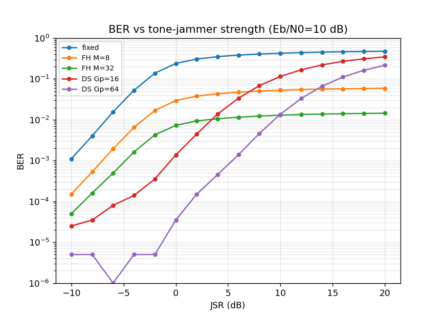
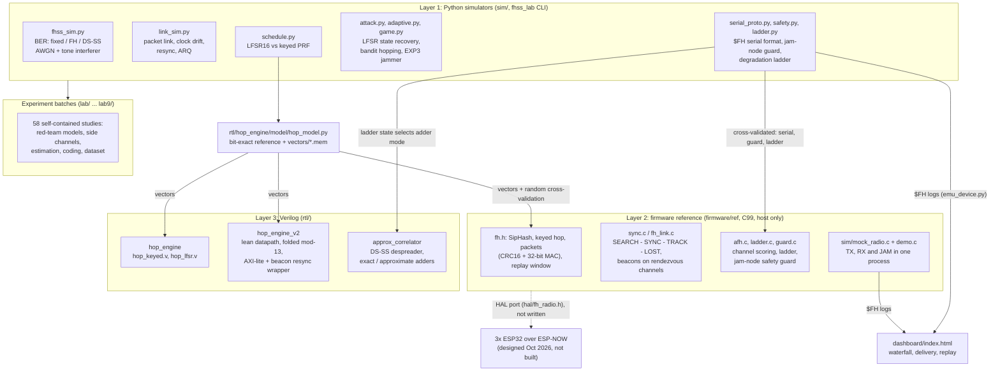

# FHSS-Link

> **Status: frozen, 2026-11-23.** No new work is planned in this repository. **Not done:** the one
> measurement the whole study rests on, the ESP-NOW channel-switch time on a real board, was never taken, so
> every timing constant here is an assumption. The part worth reading is the keyed hop engine in Verilog
> (`rtl/`) and the simulation study that motivated it. HopBench, the hop-schedule benchmark that grew out of
> this project, was merged into [`hopbench/`](hopbench/) on the same date.

**A frequency-hopping link that survives interference: studied in simulation, specified as host-tested portable C, and backed by a keyed hop-sequence engine in Verilog.**

[](https://github.com/Kavin-Re/FHSS-Link/actions/workflows/tests.yml)


FHSS-Link asks one question and follows it down the stack: *why does a pseudo-random frequency-hopping link keep working when a fixed-frequency link is knocked out by in-band interference, and what does it take to keep that advantage against an adversary who is listening?*

> **Status, stated plainly.** Everything in this repository is simulation, host-side C tests, RTL simulation, formal checks and synthesis *estimates*. **Nothing here has run on an ESP32, an FPGA or any radio**, and no RF measurement exists in this repo. The three-board ESP32 demo in [`docs/SPEC.md`](docs/SPEC.md) is designed and has a bring-up checklist, but the radio HAL port is not written. See [Limitations](#limitations).

## What it shows

All numbers below are printed by scripts in this repository (source given in each row) and come with the model assumptions listed in the linked notes. They are properties of the models, not of a real link.

| # | Result | Number | Where it comes from |
|---|---|---|---|
| 1 | A fixed-frequency BPSK link under a tone interferer is effectively lost | BER 0.24 at JSR 0 dB, 0.43 at 10 dB (Eb/N0 10 dB) | `python3 -m fhss_lab run`, [`docs/RESULTS.md`](docs/RESULTS.md) |
| 2 | Hopping over M channels caps the damage at about 1/M, independent of jammer power | BER at JSR 10 dB: M=8 0.053, M=32 0.013, M=64 0.0064 | `sim/run_all.py`, `sim/figures/3_fh_vs_M_jsr10.png` |
| 3 | Packet level, 13 channels, one jammed channel | delivery 0.05 fixed vs 0.92 hopping; 0.997 with up to 3 transmissions | `python3 sim/link_sim.py` |
| 4 | **A 16-bit LFSR hop schedule is not a secret**: an observer who knows the generator recovers the state from the channel sequence alone | 8 observed hops for 62.5 % of seeds, 9 for the other 37.5 % (exhaustive over all 65,535 seeds, M=13); delivery then falls from 0.92 to about 0.05 | `rtl/hop_engine/model/lfsr_hops_exhaustive.py`, `sim/attack.py` |
| 5 | A keyed PRF schedule keeps the same attacker at chance | delivery stays about 0.92 | `sim/test_attack.py`, `sim/schedule.py` |
| 6 | The keyed schedule in hardware costs about 17x the LFSR engine | SipHash-2-4 + Lemire reduction: 8,364 GE, 12 clocks/hop vs LFSR16 mod 13: 487 GE, 1 clock/hop (Yosys + sky130 estimate, no place and route) | [`rtl/hop_engine/README.md`](rtl/hop_engine/README.md) |
| 7 | RTL, C and Python implementations of the keyed hop agree bit for bit | 0 mismatches over 106,000 vector hops in C (re-run here) and over the same vector sets in RTL simulation (stored iverilog logs; 60,000 hops on the default configuration) | `make -C firmware/ref test`, `rtl/*/results/sim_iverilog.log*` |
| 8 | Learning which channels are bad helps against fixed or slow interference and is neutral against a learning jammer | +11 to 14 points over blind hopping (static / moving set); every policy ends at 0.92 against an EXP3 jammer | `sim/adaptive.py`, `sim/game.py` |
| 9 | Approximate adders in a DS-SS despreading correlator are a modest trade, not a free lunch | LOA K=3 saves about 21 % static area but costs 1.3x to 2.4x BER at 4 dB even with bias compensation; a run-time exact/approximate switch makes the block 13 to 16 % *larger* | [`rtl/wave2/RESULTS.md`](rtl/wave2/RESULTS.md) |

Rows 5 and 7 need one caveat each. Row 5 holds against *this* attacker; the keyed schedule's real strength
rests on SipHash being a PRF, not on a simulation. Row 7 is agreement between three implementations written by
the same author from one specification: it shows that they match each other, not that the specification is
right. The outside anchor is the published SipHash test vectors, which the Python model reproduces.

Result 4 is the hinge of the project. The LFSR is maximal-length (period 65,535) and passes a uniformity test, and it is still useless as a hop *secret*; the rest of the repository is built around replacing it with a keyed PRF and checking that replacement at every layer.



*Figure produced by `sim/run_all.py` (200,000 bits per point, fixed seed).*

## Architecture

One hop-schedule definition, `channel = Lemire(SipHash-2-4(key, slot))`, is implemented three times (Python, C, Verilog) and the implementations are tied together by generated test vectors.



| Layer | Path | Language | What exists | How it is checked |
|---|---|---|---|---|
| Simulators | `sim/`, `fhss_lab/` | Python + numpy | BER and packet-level models, attackers, adaptive policies, FEC, serial format, emulated board, classifier, safety guard | theory vs Monte Carlo and assertion tests (`sim/test_*.py`) |
| Experiment batches | `lab/` ... `lab9/` | Python + numpy | 58 studies with stored outputs, figures and per-lab results notes | one assertion test file per lab |
| Firmware reference | `firmware/ref/` | C99, no dynamic allocation | hop, packet, sync, AFH, ladder, guard and serial logic behind a radio HAL; mock radio; 3-node host demo | unit tests, RTL vectors, C-vs-Python cross-validation, ASan/UBSan, fuzz harness |
| RTL | `rtl/` | Verilog-2001 | keyed hop engine (two generations), LFSR reference, register wrapper, DS-SS correlator | self-checking testbenches vs Python vectors, mutation checks, SymbiYosys proofs, Yosys/sky130 estimates |
| Dashboard | `dashboard/index.html` | single-file HTML/JS | channel waterfall, rolling delivery, interference guess; built-in simulator or replay of a `$FH` log | manual (headless-browser check described in `docs/RESULTS.md`) |
| Hardware | `firmware/README.md`, `firmware/ref/docs/BRINGUP_28OCT.md` | n/a | plan and bring-up checklist only | not started |

A note on names: there is **no ESP32 firmware** in this repository. `firmware/ref` is the portable logic an ESP32 port would call, exercised on x86-64 only. And the "correlator" is a DS-SS *despreading* correlator used to study approximate arithmetic; it is not a hop-synchronisation correlator. Synchronisation is done with authenticated beacons on rendezvous channels (`firmware/ref/src/sync.c`).

## Lab progression

Each folder is a batch of small, self-contained experiments built on (or deliberately independent of) `sim/`. Every batch has stored outputs, figures and a test file; every results note lists its own caveats.

| Folder | Theme | Experiments | Results note | Tests (run here) |
|---|---|---|---|---|
| `sim/` | Core: why hopping works and when it stops working | BER models, packet link, LFSR break, keyed schedule, adaptive hopping, EXP3 arms race, FEC, serial protocol, emulated board, jammer classifier; round 2: FH-MFSK, key from the channel, localisation, LPD, degradation ladder, relay, energy attack, protocol model checker, randomness tests, digital twin, safety guard | [`docs/RESULTS.md`](docs/RESULTS.md), [`docs/RESULTS_ROUND2.md`](docs/RESULTS_ROUND2.md) | 6 test files + `modelcheck.py` |
| `lab/` | Spread spectrum outside the link | GPS-style code acquisition, spread-spectrum image watermark, frequency hopping over audio (`lab/audio/*.wav`), modulation classifier | [`docs/RESULTS_R3_A.md`](docs/RESULTS_R3_A.md) | `test_batchA.py` |
| `lab2/` | Theory and estimation | control over a lossy link, Kalman clock tracking, transmitter fingerprinting, jammer/defender matrix game (LP), capacity of the jammed link, compressed-sensing spectrum sensing, co-evolution | [`docs/RESULTS_R3_B.md`](docs/RESULTS_R3_B.md) | `test_batchB.py` |
| `lab3/` | Systems and tooling | survival telemetry codec, tamper-evident hash-chain log, LMS interference canceller, Wi-Fi survey tooling (synthetic data only), congested-venue model, packaging, simulated jammer-classification dataset | [`docs/RESULTS_R3_C.md`](docs/RESULTS_R3_C.md) | `test_batchC.py` |
| `lab4/silicon/` | The hop engine as a silicon target (models with assumed leakage) | CPA and first-order masking, fault injection, hardware trojan, PUF | [`lab4/silicon/RESULTS_SILICON.md`](lab4/silicon/RESULTS_SILICON.md) | `run_tests.py` (36) |
| `lab5/` | Receiver and protocol hardening | approximate correlator, fast-hop jammer, relay attack, soft-set hopping, replay with rolling counter + MAC, graceful degradation, regret-matching cross-check | [`lab5/RESULTS_LAB5.md`](lab5/RESULTS_LAB5.md) | `test_lab5.py` |
| `lab6/` | Red team 1: attacking the learner and the control plane | bandit poisoning, learning-rate attack, control-plane (beacon) jamming, time pushing, PRNG graveyard, key-from-air entropy drain, myopic jammer, scorecard | [`lab6/RESULTS_LAB6.md`](lab6/RESULTS_LAB6.md) | `test_lab6.py` (11) |
| `lab7/` | Beyond the jammer 1 | timing side channel on tag compare, carry-off spoofing, parser/CRC fuzzing, Dolev-Yao model check of the guard, permutation-epoch leak, traffic analysis, jamming-avoidance response, red/blue loop | [`lab7/RESULTS_LAB7.md`](lab7/RESULTS_LAB7.md) | `test_lab7.py` (65 checks) |
| `lab8/` | Red team 2: space and energy | jammer placement, swarm vs single jammer, energy-optimal jammer, capture effect, honeypot channels, moving-target link | [`lab8/RESULTS_LAB8.md`](lab8/RESULTS_LAB8.md) | `test_lab8.py` (14 tests) |
| `lab9/` | Beyond the jammer 2 | trojan hunt, power analysis, fingerprint forgery, adversarial modulation classifier, poisoned logs, crypto DoS, max-entropy hopping | [`lab9/RESULTS_LAB9.md`](lab9/RESULTS_LAB9.md) | `test_lab9.py` (47 checks) |

All of these are models of attacks on the project's own simulated link, each ending in a defensive lesson. A claim-by-claim evidence table is in [`docs/defence/CLAIMS_vs_EVIDENCE.csv`](docs/defence/CLAIMS_vs_EVIDENCE.csv).

The folders are named `lab`, `lab2`, ... rather than grouped under one `labs/` directory because the stored outputs, results notes and the evidence table cite those paths about 240 times; they were left in place so the evidence trail stays intact.

## Quick start

Requirements: Python 3.9+ with `numpy` (and `matplotlib` for figures). The firmware reference needs `make` and a C99 compiler. The RTL needs Icarus Verilog (and, for the full flow, Verilator, Yosys, z3 and SymbiYosys).

```bash
git clone https://github.com/Kavin-Re/FHSS-Link.git && cd FHSS-Link
pip install numpy matplotlib
./run_tests.sh                     # everything that needs only Python + a C compiler (about 3-5 minutes)
```

### Layer 1: simulators

```bash
python3 -m fhss_lab run            # BER table: fixed vs FH vs DS under a tone interferer, plus PDR vs M
python3 -m fhss_lab bench          # the sim/ tests with real exit codes
python3 -m fhss_lab emulate --jammer sweep --slots 3000 --out demo.log     # $FH serial log from the emulated board
python3 -m fhss_lab classify       # jammer classifier accuracy (simulated windows)
(cd sim && python3 run_all.py)     # regenerate sim/figures/ and results.json
(cd sim && python3 link_sim.py)    # packet-level link table
```

Docker, if you prefer not to install anything: `docker build -t fhss-lab . && docker run --rm fhss-lab bench`.

Each lab runs from its own folder, for example `(cd lab7 && python3 run_all.py && python3 test_lab7.py)`. Two files in `lab9/` (`test_b14_dos.py`, `test_b21_maxent.py`) are fragments loaded by `test_lab9.py` and are not meant to be run on their own.

### Dashboard

Open `dashboard/index.html` in a browser (no server, works offline). Source = *Simulator* runs a built-in model; Source = *Replay* loads a `$FH` log such as the one written by `fhss_lab emulate` or by `make -C firmware/ref logs`. The line format is in [`docs/SERIAL_FORMAT.md`](docs/SERIAL_FORMAT.md).

### Layer 2: firmware reference (host)

```bash
cd firmware/ref
make test        # unit tests + hop_engine vectors + cross-validation against the Python references
make san         # the same under ASan/UBSan, plus the fuzz harness and the full 3-node demo
make nomalloc    # no allocator symbols in the library objects
make logs        # deterministic demo logs (logs/fw_*.log) for the dashboard
```

What is and is not validated: [`firmware/ref/docs/VALIDATION.md`](firmware/ref/docs/VALIDATION.md). What an ESP32 port still needs: [`firmware/ref/docs/BRINGUP_28OCT.md`](firmware/ref/docs/BRINGUP_28OCT.md).

### Layer 3: RTL

```bash
sudo apt-get install iverilog
rtl/sim_committed_vectors.sh       # all 26 testbench runs against the committed Python-model vectors
```

The original per-block flows (`rtl/hop_engine/scripts/run_all.sh`, `rtl/wave2/run_all.sh`) also regenerate vectors, run Verilator, the SymbiYosys proofs and Yosys/sky130 synthesis. They expect a sky130 liberty file and SymbiYosys sources that are not in this repository; paths and versions are in [`rtl/hop_engine/README.md`](rtl/hop_engine/README.md) and [`rtl/hop_engine/TOOLS_READY.txt`](rtl/hop_engine/TOOLS_READY.txt). The correlator model additionally needs the separate ApproxKit repository (`APPROXKIT=/path/to/ApproxKit`).

Python-only checks of the RTL reference model run anywhere:

```bash
python3 rtl/hop_engine/model/hop_model.py                 # SipHash-2-4 against published vectors, Lemire uniformity
python3 rtl/hop_engine/model/unbias_check.py              # exact integer proof that the reduction is unbiased
(cd rtl/hop_engine && python3 model/lfsr_hops_exhaustive.py)   # the 8-or-9-hop LFSR break, all 65,535 seeds
```

## Verification status

| Check | Stored evidence in the repo | Re-run for this README (Nov 2026, Python 3.13 / numpy 2.5 / gcc, x86-64) |
|---|---|---|
| `sim/` tests, `lab` ... `lab9` tests, hop-model self-tests | per-lab `outputs/` | yes, all pass (`./run_tests.sh`) |
| Firmware reference: `make test`, `make nomalloc`, `make san` | `firmware/ref/logs/*.summary.txt`, `*.events.txt` | yes, all pass (sanitizer run with 200,000 fuzz iterations per seed instead of 2,000,000); `make logs` reproduces the stored summaries byte for byte |
| RTL test vectors regenerate identically from the Python models | `rtl/*/vectors/` | yes (hop_engine, hop_engine_v2, approx_correlator) |
| RTL simulation (iverilog 12): 7 + 12 + 7 testbench runs PASS | `rtl/hop_engine/results/sim_iverilog.log.txt`, `rtl/hop_engine_v2/results/sim_iverilog.log`, `rtl/approx_correlator/results/sim_iverilog.log` | **no** (no Verilog simulator available); stored logs only |
| Verilator re-run and lint | `rtl/*/results/lint.txt`, `rtl/hop_engine/results/sim_verilator.log.txt` | no; stored logs only |
| Formal (SymbiYosys k-induction, z3) and SAT equivalence of the dual adder | `rtl/*/results/formal.log*`, `rtl/approx_correlator/results/equiv_dual.log` | no; stored logs only |
| Testbench mutation checks (28 hand-made bugs, all caught) | `rtl/hop_engine_v2/results/mutation.txt` | no; stored log only |
| Synthesis estimates (Yosys 0.33 + abc, sky130_fd_sc_hd) | `rtl/*/results/SUMMARY.txt`, `results/synth/` | no; stored reports only |

CI (`.github/workflows/tests.yml`) runs the first two rows on every push, and an advisory job runs `rtl/sim_committed_vectors.sh` with Icarus Verilog from apt.

## Limitations

- **No hardware.** No ESP32 build, no radio, no FPGA, no silicon. The ESP-NOW channel-switch time, real slot timing, RSSI behaviour and real 2.4 GHz interference are all unmeasured. Every timing constant in `fh_cfg_default` is an assumption.
- **The channel models are simple.** BPSK over AWGN with a continuous tone; packet loss as a fixed probability on a jammed channel (0.95) and on a clean one (0.01). No multipath in the core model, no adjacent-channel leakage, no capture effect outside `lab8`.
- **The core BER model assumes perfect hop synchronisation.** Sync loss is modelled only at packet level (`sim/link_sim.py`) and in the firmware reference's mock medium, which has zero air time and zero channel-switch time.
- **Classifier and dataset numbers are simulator-on-simulator.** 99 % accuracy on windows drawn from the same model is an upper bound, not a prediction for real RF. `lab3/dataset` is labelled SIMULATED throughout; the Wi-Fi survey figures use synthetic data.
- **RTL numbers are tool estimates.** Area and delay come from Yosys + abc without placement, routing, clock tree or sign-off timing, and area and delay columns come from different mappings (explained in `rtl/hop_engine/README.md`). No power numbers, no gate-level simulation.
- **Formal proofs cover safety properties, not function.** They show legal FSM states, `chan < M`, slot-counter behaviour and protocol obligations. Equivalence with SipHash rests on simulation against the Python model, which is in turn anchored to published SipHash test vectors.
- **Security claims are conditional.** SipHash-2-4 is a short-input PRF with a 64-bit output, not a standardised cipher; "2^128" is the generic key-search bound. The frame MAC is truncated to 32 bits. Key distribution, pairing, re-keying and payload encryption are out of scope. No real side-channel or fault measurements exist; `lab4/silicon` and `lab9` attack assumed leakage models.
- **The side-channel, trojan and PUF labs measure models of their own assumptions.** What transfers is the shape of each result, not the absolute numbers.
- **`corr_mode_ctrl` needs `2 <= DWELL <= 2^CWID`.** With `DWELL = 1` the dwell counter would never match and the block would wait for a 4-bit wrap; the shipped configurations (8 and 3) are unaffected.
- **Some stored evidence is incomplete.** The v1 hop engine's raw synthesis and first-run logs were not all kept (noted in its README), and the sky130 liberty file and SymbiYosys sources needed to reproduce the full RTL flow are fetched from upstream, not vendored.

## Roadmap

Frozen on 2026-11-23: **nothing below is scheduled.** The list is kept as the record of what the project
would need next, in order.

1. **ESP32 bring-up** (planned in October 2026, never started): write the `hal/fh_radio.h` port for ESP-NOW,
   measure channel-switch time, then run the two-board link and the guarded interference node per the bring-up
   checklist. This is the step that would turn every "assumed" timing constant into a measured one.
2. **Measured results**: packet delivery with and without hopping under one controlled interferer on the owner's own test link; replay the real `$FH` logs through the dashboard and the classifier.
3. **FPGA**: place-and-route the keyed hop engine and the register wrapper for a real device and replace the abc delay estimates with post-route timing.
4. **Sync correlator**: a preamble/PN acquisition correlator in RTL (the present correlator only despreads).
5. **CODED mode**: implement the (7,4) erasure code in the firmware reference so bulk goodput matches `sim/ladder.py`.
6. **Key handling**: pairing, re-keying and persistent rolling-counter storage, which are where fielded hopping links are usually broken.

The original dated plan is kept in [`docs/ROADMAP.md`](docs/ROADMAP.md).

## HopBench (merged from its own repository)

[`hopbench/`](hopbench/) is a benchmark that scores nine hop schedules (seven built in, two controls) against
eleven simulated attackers and ten randomness tests, and a browser game, "Break the Hop". It was a separate
repository until 2026-11-23 and is copied here unchanged except for the small notes listed in
[`hopbench/ORIGIN.md`](hopbench/ORIGIN.md), which also records the origin commit. Its headline repeats result 4 above
from a different angle: keyed schedules score about 99.9 out of 100 against this suite, the LFSR about 20.

```bash
cd hopbench
python3 -m pip install -r requirements-dev.txt
python3 -m pytest -q                          # 93 tests; the browser test skips itself without Playwright
python3 -m hopbench run --out /tmp/hb --jobs 4   # the reference run behind hopbench/results/ (under a minute)
```

A HopBench score is relative to its attacker suite. It is not a security proof.

## Repository map

```
sim/            core simulators, attackers, policies, FEC, serial format, tests, figures/
fhss_lab/       command-line wrapper around sim/        (python -m fhss_lab --help)
lab/ lab2/ ... lab9/   experiment batches (see the table above)
firmware/ref/   portable C99 link logic, mock radio, host demo, tests, fuzz harness
rtl/            hop_engine, hop_engine_v2, approx_correlator, wave2 results
dashboard/      single-file live dashboard
hopbench/       schedule benchmark and browser game (merged from the HopBench repository)
docs/           SPEC, results notes, serial format, landscape survey, defence/ (viva material)
logs/           decision log written by sim/ladder.py
run_tests.sh    one command for every Python and host-C test
```

[`docs/INDEX.md`](docs/INDEX.md) is the original index of results notes; [`docs/LANDSCAPE.md`](docs/LANDSCAPE.md) places the project against existing open-source work (ExpressLRS and others) and says where it is a replication rather than a new result.

## Responsible use

The interference source in this project is a model, and in the hardware demo designed in October 2026 (never built) it is a minimum-power node on the owner's own test link in a closed room, behind a software guard with duty-cycle limits, an authorisation token and a kill switch (`sim/safety.py`, `firmware/ref/src/guard.c`). Jamming other people's communications is illegal in most jurisdictions and is not what this repository is for.

## Credits and license

Author: Kavin K K ([@Kavin-Re](https://github.com/Kavin-Re)). The dated working notes in `docs/` are kept as the project's record.

The adder cells in `rtl/approx_correlator/rtl/ak_cells/` are copied unmodified from the author's ApproxKit project. SipHash is by Jean-Philippe Aumasson and Daniel J. Bernstein; the unbiased range reduction follows Daniel Lemire.

Copyright 2026 Kavin K K. Licensed under the [Apache License, Version 2.0](LICENSE); see also [NOTICE](NOTICE). Two exceptions keep their own terms: `lab3/dataset/`, whose README carries its own MIT notice, and the adder cells in `rtl/approx_correlator/rtl/ak_cells/`, which are MIT-licensed as part of ApproxKit.
